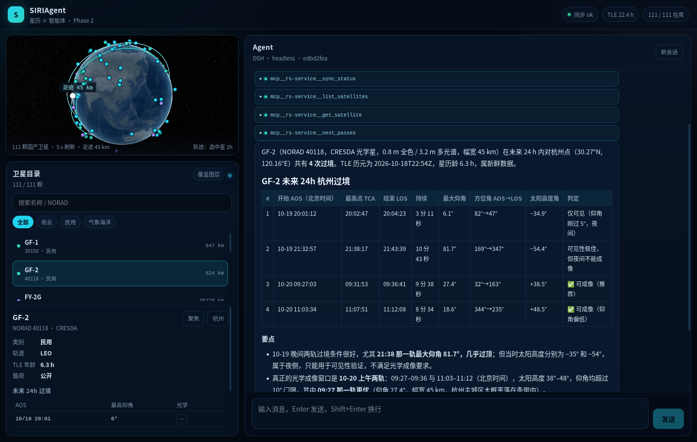
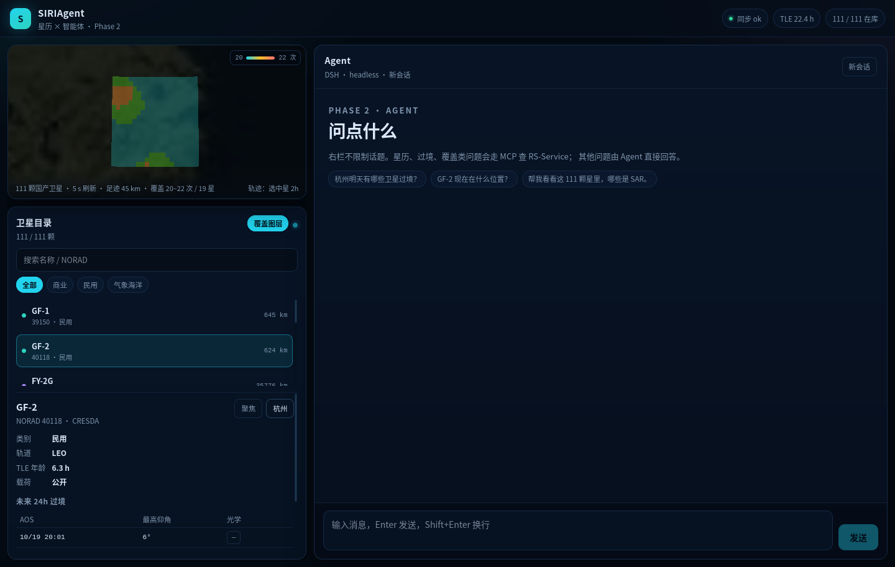

# SIRIAgent

Phase 2 的双栏平台：左 1/3 星历可视化，右 2/3 Agent。它**不修改** `SIRI-Agent` 项目，只在自己的目录里运行。

> Phase 2 的范围、优先级与验收标准见 [`docs/PHASE2-REQUIREMENTS.md`](docs/PHASE2-REQUIREMENTS.md)（[HTML 版](docs/PHASE2-REQUIREMENTS.html)，由 `scripts/build_requirements_html.py` 生成）。后续需求变更只改该文档，不再写入 `SIRI-Agent`。
>
> Agent 在本仓库的工作约定见 [`AGENTS.md`](AGENTS.md)。



覆盖图层：点「杭州」直接飞到杭州 AOI 并打开 24h 覆盖热力图（150 km、19 颗高分辨率星，20–22 次/格）。



## 它是什么

```text
浏览器
  │  https://siriagent.dpdns.org（Cloudflare Access 保护）
  ▼
Cloudflare Tunnel
  ▼
127.0.0.1:8000  gunicorn + Flask（本项目）
  ├─ /            → web/dist（React + Cesium）
  ├─ /api/rs/*    → 127.0.0.1:8766（RS-Service REST）
  └─ /api/chat    → dsh --profile headless --json
  ▼
DSH agent（DeepSeek Harness） + RS-Service（星历/MCP）
```

- 前端：`web/`，React 19 + Vite + TypeScript + CesiumJS；构建产物 `web/dist/` 由 Flask 托管。
- 历史页面：`static/index.html`，仅在 `web/dist` 不存在时兜底。
- 后端：`app.py`，Flask；`/api/rs/*` 反代到本机 RS-Service，浏览器不直连 8766。
- DSH：`dsh --profile headless`，每次消息一次运行；用 `--session-id` 续聊。
- 端口：`127.0.0.1:8000`，与原来的平台一致，Tunnel 不需要改。

## 前端开发

```bash
cd "/home/siri/桌面/SIRIAgent/web"
pnpm install
pnpm dev          # 开发服务器 5173，/api 代理到 8000
pnpm build        # 产物写入 web/dist，Flask 自动托管
```

前端依赖 RS-Service 的 REST（`127.0.0.1:8766`）。相机控制：「聚焦」飞到选中星足迹，「杭州」飞到杭州 AOI 并打开覆盖图层。时间轴 UI 暂不启用，后端 `at` 参数保留。启动顺序：

```bash
systemctl --user start rs-service-api.service   # 星历服务
systemctl --user restart siriagent-demo          # 前端 + DSH
```

## SDK 流式

`/api/chat/stream` 用 DSH Python SDK 的事件流：`tool_call` / `tool_result` 实时出现，文本在回合结束时整块返回（当前 SDK 版本不吐 token delta）。SDK 缺省时前端会回退到 `/api/chat`。

本机安装（SDK 不在仓库内）：

```bash
~/.local/bin/uv pip install --python .venv/bin/python pydantic
~/.local/bin/uv pip install --python .venv/bin/python --no-deps -e \
  /home/siri/Documents/Qoder/2026-10-18/146d1f32/deepseek-harness/python/sdk
```

- `SDK_DSH_HOME` 默认 `~/.dsh-siriagent`，首次运行会从 `~/.dsh/.credentials.yaml` 复制凭据。
- 模型默认 `deepseek-official / deepseek-flash`，可用 `DSH_PROVIDER` / `DSH_MODEL` 覆盖。
- 同一时刻只跑一轮（进程内锁）；多人并发要等 Phase 3 的会话池。

## 运行

```bash
cd "/home/siri/桌面/SIRIAgent"

# 一次性建环境（本机已用 uv 装好 Python 3.12）
~/.local/bin/uv venv --python 3.12 .venv
~/.local/bin/uv pip install --python .venv/bin/python -r requirements.txt

# 前台启动
.venv/bin/gunicorn -w 1 --threads 4 --timeout 300 -b 127.0.0.1:8000 app:app
```

打开 <http://127.0.0.1:8000>。

## 配置

| 环境变量 | 默认值 | 说明 |
| --- | --- | --- |
| `DSH_ROOT` | `/home/siri/Documents/Qoder/2026-10-18/146d1f32/deepseek-harness` | DSH checkout |
| `DSH_CLI` | `$DSH_ROOT/apps/cli/lib/bin.js` | 构建后的 CLI 入口 |
| `NODE_BIN` | `/home/siri/local/node-v22.20.0-linux-x64/bin/node` | node 可执行文件 |
| `DSH_TIMEOUT` | `240` | 单次 DSH 运行超时（秒） |
| `DSH_PROXY` | 无 | 可选，覆盖 HTTPS_PROXY/HTTP_PROXY |
| `MAX_MESSAGE_CHARS` | `12000` | 单条消息长度上限 |

`headless.patch.yml` 做了两件事：

1. 让 headless 使用 DSH 已保存的凭据（默认 headless 会禁用存储凭据）；
2. 把权限固定为 `workspace-write` + `approval: never`，这样 agent 可以在本项目内读写、跑命令，但不会卡在无人应答的审批上。

## systemd（用户级）

```bash
systemctl --user disable --now siriagent        # 停掉旧项目占用的 8000
mkdir -p ~/.config/systemd/user
cat > ~/.config/systemd/user/siriagent-demo.service <<'UNIT'
[Unit]
Description=SIRIAgent demo UI (DSH-backed)
After=network-online.target
Wants=network-online.target

[Service]
WorkingDirectory=/home/siri/桌面/SIRIAgent
Environment=NODE_BIN=/home/siri/local/node-v22.20.0-linux-x64/bin/node
Environment=HTTPS_PROXY=http://127.0.0.1:7890
Environment=HTTP_PROXY=http://127.0.0.1:7890
ExecStart=/home/siri/桌面/SIRIAgent/.venv/bin/gunicorn -w 1 --threads 4 --timeout 300 -b 127.0.0.1:8000 app:app
Restart=on-failure
RestartSec=5

[Install]
WantedBy=default.target
UNIT
systemctl --user daemon-reload
systemctl --user enable --now siriagent-demo
```

## API

- `GET /api/health`：检查 DSH CLI、patch、node 是否就绪。
- `POST /api/chat`：`{"message": "...", "session_id": "..."}`，返回最终文本、session、thinking、usage、耗时。

## 已知限制

- 不是 token 级流式：DSH headless 完成后一次性返回，前端只显示“思考中”。
- 每条消息启动一个 DSH 进程，冷启动有开销；并发高时不适合。
- DSH 会话持久化在 `~/.dsh/sessions`，同一个 `session_id` 可续聊。
- 这是验证台，不是生产平台：没有平台级用户体系，依赖 Cloudflare Access。
